# XFeat × RoMa：輕量與全局影像配對的比較與改善

> I2ML-2026 Investigation Track 專題 README  
> 本專案先把 XFeat 與 RoMa 都當作 baseline，分析兩者在搜尋範圍、座標定位、準確率和速度上的取捨，再用目前的互動與粗到細實驗提出可驗證的改善。歷史數字是 pilot 證據，不是最後模型成果。

## 研究問題

給定兩張不同視角的場景影像，我們要找到代表同一個三維位置的像素對應，並把這些對應交給幾何估計器恢復相機相對姿態。

本專案回答四個問題：

1. XFeat 的稀疏候選點為什麼速度快？它在哪些情況下漏掉正確座標？
2. RoMa 的全局 coarse matching 與 coarse-to-fine refinement 為什麼比較能處理大範圍和連續座標？
3. 兩個 baseline 的準確率、CPU 延遲、記憶體和資料需求差多少？
4. 保留 XFeat backbone 的效率，再加入少量上下文、全局相關性或座標細化，哪一種組合最值得繼續訓練？

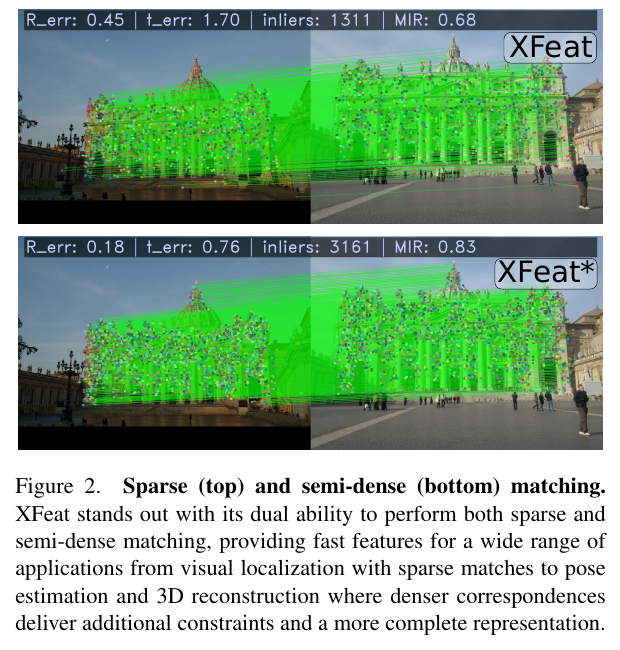

*圖 1：XFeat 論文 Figure 2。上排為 sparse matching，下排為 semi-dense matching；綠色線段是兩張影像的對應，可用於姿態估計與 3D 重建。來源：[XFeat: Accelerated Features for Lightweight Image Matching, CVPR 2024](https://openaccess.thecvf.com/content/CVPR2024/papers/Potje_XFeat_Accelerated_Features_for_Lightweight_Image_Matching_CVPR_2024_paper.pdf)。*

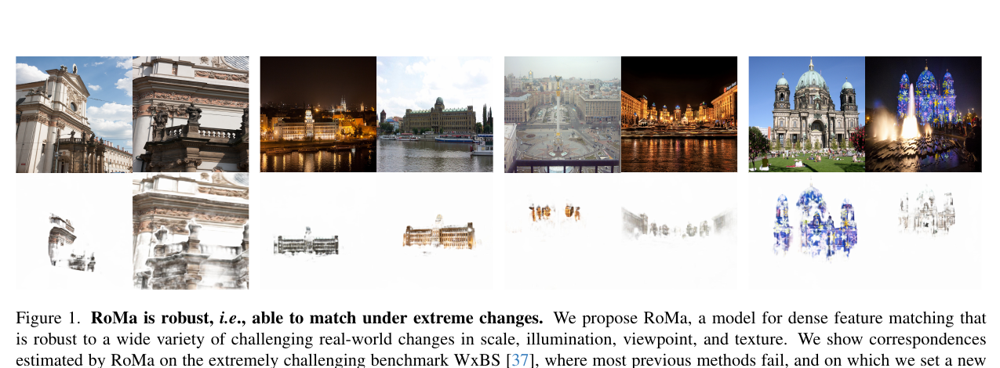

*圖 2：RoMa 論文 Figure 1。不同視角、光線與紋理條件下，模型輸出密集對應的視覺化。來源：[RoMa: Robust Dense Feature Matching, CVPR 2024](https://openaccess.thecvf.com/content/CVPR2024/papers/Edstedt_RoMa_Robust_Dense_Feature_Matching_CVPR_2024_paper.pdf)。*

## 兩個 baseline 的定位

| 比較項目 | XFeat baseline | RoMa baseline |
|---|---|---|
| 特徵 | 輕量共享 CNN，多尺度特徵與 64D descriptor | 粗尺度 foundation features 加專用 fine features |
| 搜尋 | detector 選出的稀疏候選點 | 粗特徵圖上的全局位置分布 |
| 座標 | 受候選點位置限制 | 先輸出連續 coarse 座標，再局部細化 |
| 匹配輸出 | sparse pairs，可做 MNN 篩選 | dense / semi-dense correspondence 與 confidence |
| 優勢 | CPU 速度快、記憶體低、易部署 | 大範圍搜尋與幾何定位較完整 |
| 限制 | 正確位置若不在候選集合，後端無法補出 | 全局相關性與粗細解碼成本較高 |
| 本專案角色 | 效率 baseline | 準確率與完整搜尋 baseline |

Baseline 的意思是共同比較起點，不代表其中一個一定是最後方法。後續所有改善都要同時回報相對 XFeat 和相對 RoMa 的差距。

## XFeat baseline 架構

這張圖依照提供的 G2L_XFeat_architecture 簡報重新整理，將 backbone、三個尺度、skip fusion、descriptor 與配對介面分開畫出。

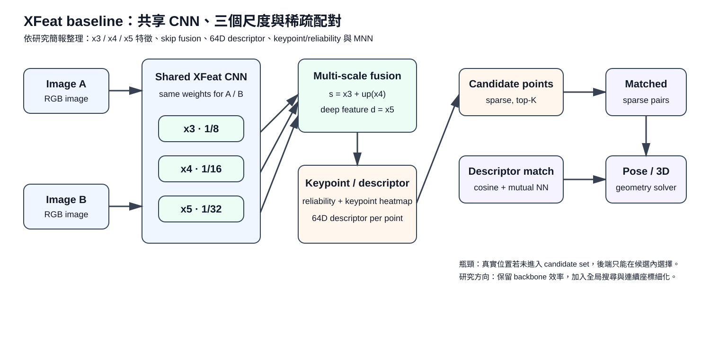

*圖 3：XFeat baseline 的清楚版架構。x3 約為 1/8、x4 約為 1/16、x5 約為 1/32；融合後產生 keypoint/reliability 與 64D descriptor，最後只在有限候選點上做相似度配對。*

流程：

```text
Image A / Image B
  → shared XFeat CNN
  → x3 (1/8), x4 (1/16), x5 (1/32)
  → s = x3 + up(x4), deep feature d = x5
  → keypoint / reliability + 64D descriptor
  → sparse candidate points
  → descriptor similarity + mutual nearest filtering
  → matched pairs → pose / 3D geometry
```

XFeat 快的原因是它不建立兩張完整特徵圖的所有位置關係，而只處理有限候選。但候選介面也造成明確瓶頸：

```text
真實連續位置：       ×
已選候選位置：          ●     ●
```

若真值落在候選集合之外，即使 descriptor 已經辨認出正確物體，也只能輸出候選集合中的近似位置。

## RoMa baseline 架構

RoMa 不是把 XFeat 的候選點再加大，而是改變搜尋介面：先在粗尺度對整張特徵圖建模，再把 coarse 結果交給 fine refinement。

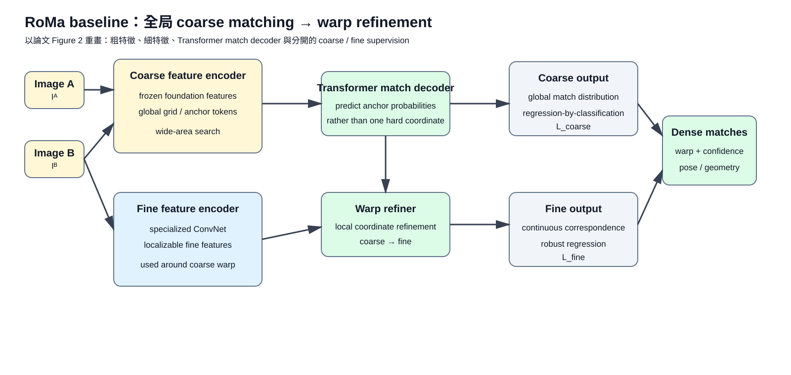

*圖 4：依 RoMa 論文 Figure 2 重畫的 baseline 流程。粗特徵、細特徵、Transformer match decoder、warp refiner 和兩種 supervision 分開表示。*

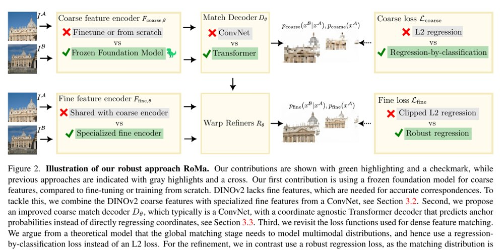

*圖 5：RoMa 論文 Figure 2 原圖裁切，保留作者對 coarse encoder、fine encoder、match decoder 與 loss 的設計說明。*

流程：

```text
Image A / Image B
  → frozen foundation coarse features
  → global coarse matching distribution
  → anchor probabilities / continuous coarse coordinate
  → specialized fine features
  → warp refinement
  → dense correspondence + confidence
  → pose / geometry evaluation
```

RoMa 的優勢在於真值不必先被 detector 選成某個固定候選點；它可以從全局粗位置分布讀出連續座標，再在附近細化。代價是特徵、相關性、解碼和 refinement 都需要更多計算。

## 相關性與連續座標

對 A 圖位置 i 和 B 圖位置 j 的粗特徵，相關性可寫成：

$$
C(i,j)=\frac{F_A(i)^\top F_B(j)}{\sqrt{d}}
$$

對固定的 A 圖位置 i，令

$$
s_{ij}=\frac{\exp(C(i,j))}{\sum_k\exp(C(i,k))}
$$

則 B 圖的初始連續座標是：

$$
\hat p_B(i)=\sum_j s_{ij}p_B(j)
$$

這三個公式只表達「全局相似度 → 位置分布 → 連續座標期望」。實際模型還包含特徵編碼、解碼、confidence 和 refinement；不能把公式本身當成完整 RoMa 實作。

## 研究改善：XFeat backbone 上的可控模組

我們保留 XFeat 作為效率 baseline，逐步加入 RoMa 啟發的搜尋與定位能力：

```text
XFeat shared CNN
  → coarse / fine maps
  → optional one-layer self-attention
  → global correlation
  → continuous coarse coordinate
  → optional coarse refinement
  → optional fine refinement
  → final correspondence
```

研究假設：

- **H1 上下文**：一層圖內 self-attention 讓粗特徵參考同張圖的結構，減少重複紋理錯配。
- **H2 全局搜尋**：完整粗特徵圖的相關性比固定候選集合更可能覆蓋正確位置。
- **H3 座標細化**：若初始座標已在真值附近，coarse/fine refinement 能降低像素誤差；它不能保證救回遠距離錯配。
- **H4 成本**：互動層數和全局搜尋可能提高準確率，但延遲、記憶體與資料搬移會限制可用深度。

## 互動深度實驗

| 代號 | 模組 | 問題 |
|---|---|---|
| I0 | descriptor projection + basic matching head | 沒有上下文時的共同起點 |
| I1 | 加一層圖內 self-attention | 少量上下文是否足夠 |
| I2 | 圖內互動後加一層跨圖互動 | 跨圖訊息是否有額外價值 |
| I4 | 重複兩次圖內／跨圖互動 | 深度增加是否持續有效 |
| I6 | 重複六次圖內／跨圖互動 | 最高準確率是否值得延遲 |

歷史 pilot（78,042 steps、464 對 dev）：

| 分支 | Frozen AUC@5 | Unfrozen AUC@5 | Frozen CPU s/pair | Unfrozen CPU s/pair |
|---|---:|---:|---:|---:|
| I0 | 27.82% | 20.00% | 1.139 | 1.448 |
| I1 | 32.55% | 37.42% | 1.469 | 1.678 |
| I2 | 35.33% | 38.15% | 1.947 | 2.231 |
| I4 | 36.63% | 42.72% | 2.795 | 3.041 |
| I6 | 46.85% | 49.10% | 6.128 | 6.390 |

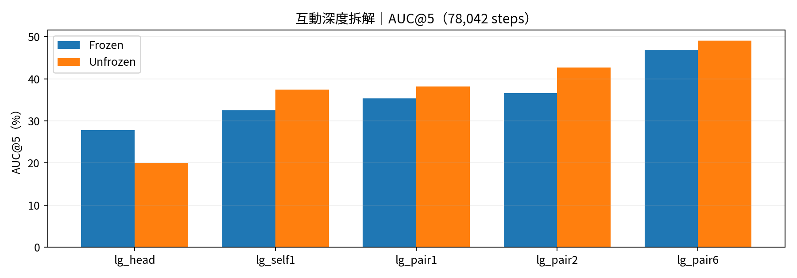

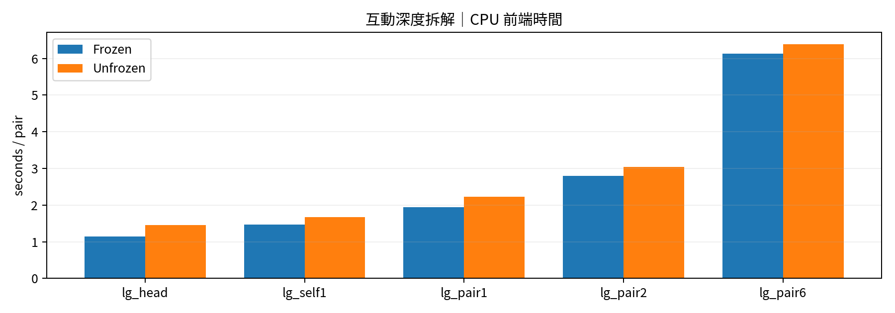

這組結果只說明互動深度與成本存在取捨；它不能直接證明一層 attention 加進新的全局搜尋後一定會提升。

## 粗到細定位實驗

| 代號 | 模組 | 問題 |
|---|---|---|
| L0 | global correlation + coordinate expectation | 只有全局座標讀出能做到什麼 |
| L1 | L0 + coarse coordinate refinement | 粗修正能救回多少初始誤差 |
| L2 | L1 + fine coordinate refinement | 細尺度還能增加多少定位精度 |

歷史 pilot：

| 分支 | Frozen AUC@5 | Unfrozen AUC@5 | Frozen CPU s/pair | Unfrozen CPU s/pair |
|---|---:|---:|---:|---:|
| L0 | 5.59% | 7.92% | 1.507 | 1.525 |
| L1 | 5.27% | 15.65% | 1.981 | 1.992 |
| L2 | 7.39% | 16.56% | 2.127 | 2.135 |

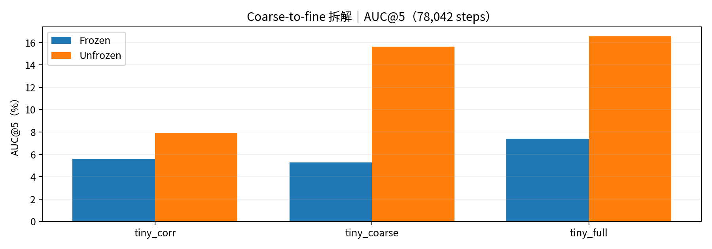

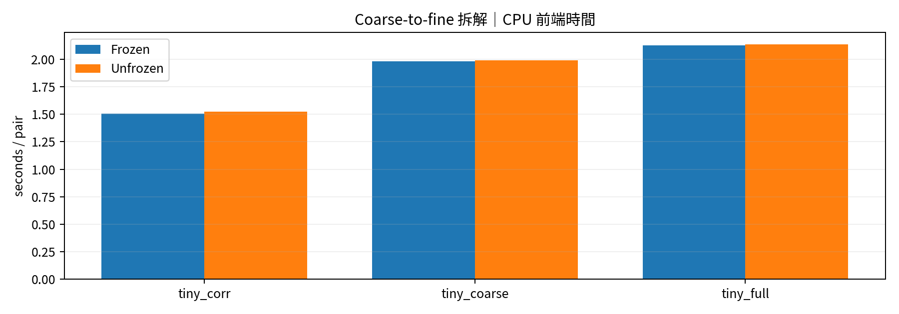

在這個 pilot 的 unfrozen 條件下，L0→L1 增加 7.73 個百分點，L1→L2 增加 0.91 個百分點。這支持先檢查 coarse stage，但不代表 fine stage 沒有作用。

## AUC@5 是什麼

AUC@5 是姿態誤差曲線在 0° 到 5° 範圍內的 area under curve，通常會正規化成百分比，越高越好。

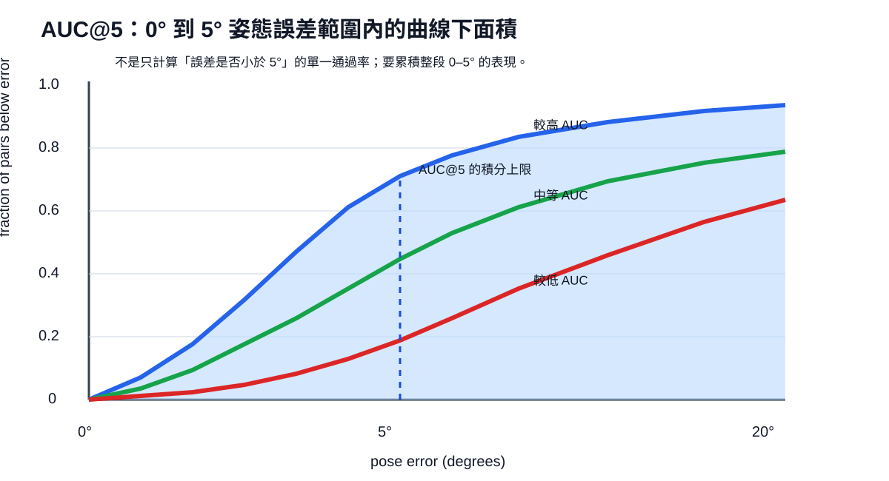

*圖 6：橫軸是估計姿態誤差，縱軸是誤差不超過該值的影像對比例。AUC@5 累積 0–5° 的整段曲線，不是只問「是否小於 5°」的單一通過率。*

本專案同時記錄：

- **AUC@5 / @10 / @20**：整個影像對經過固定姿態 solver 後的曲線面積。
- **correct@3 / correct@5**：單一配對點的像素誤差是否低於門檻。
- **Top-1 / candidate coverage**：描述子或候選介面是否找到正確位置。
- **CPU time**：固定 1 CPU、0 GPU，報告平均、p50、p95 秒／pair。

AUC、correct@3 和 candidate coverage 是不同層級的指標，不能互換。候選覆蓋變好，也不保證姿態 AUC 等比例上升。

## 資料集與驗證

### MegaDepth 的資料意義

MegaDepth 使用網路多視角影像，透過 SfM/MVS 重建場景幾何，再提供 RGB、深度、相機和可見性資訊，讓模型能從不同視角影像學習幾何對應。

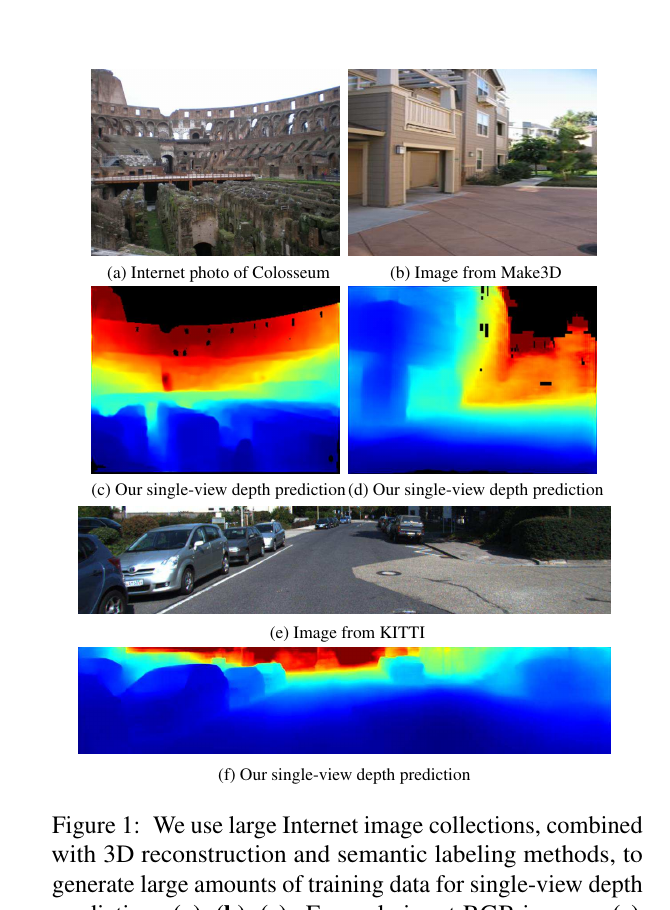

*圖 7：MegaDepth 論文 Figure 1 裁切，展示網路影像、深度預測與跨資料集泛化的資料概念。來源：[MegaDepth: Learning Single-View Depth Prediction from Internet Photos, CVPR 2018](https://openaccess.thecvf.com/content_cvpr_2018/papers/Li_MegaDepth_Learning_Single-View_CVPR_2018_paper.pdf)。這張圖用於解釋資料來源，不代表本專案已下載該論文中的所有原始檔。*

### 本專案的訓練與驗證切分

| 項目 | 設定 |
|---|---|
| 訓練來源 | MegaDepth 及其幾何標註 |
| batch | 8 對影像 |
| 長訓目標 | 每個可訓練分支累計 2,000,000 image-pair exposures |
| exposure 定義 | 累計看到的影像對，不是 2,000,000 組獨立影像，也不是 steps |
| 歷史最高提交 | 89,730 steps |
| 有完整 AUC 的 checkpoint | 15,078 與 78,042 steps |
| 歷史 dev | 464 對影像 |
| 姿態估計 | 固定 PoseLib 設定與 solver seeds |
| 資料驗證 | scene split、pair hash、相機與深度幾何 sanity check |

正式結果需要保存 manifest、scene split、資料 hash、commit、seed、checkpoint 和評估 log。pilot 只能作動機，不能取代 final evaluation。

## 目前比較與下一步

### Baseline 比較

第一階段先固定兩個 baseline：

1. **XFeat baseline**：原始稀疏候選與 descriptor matching。
2. **RoMa baseline**：原始全局 coarse-to-fine dense matching。

兩者都量測：

- Pose AUC@5/@10/@20
- correct@3/@5
- candidate coverage 或 dense correspondence coverage
- CPU 前端時間與 GPU 推論時間
- 參數量、峰值記憶體和輸入解析度

### XFeat-based 改善階段

接著才做四組可歸因的組合：

| 組合 | 上下文 | 全局／座標細化 | 目的 |
|---|---|---|---|
| baseline | 無 | 無 | XFeat 效率起點 |
| context-only | 一層 self-attention | 無 | 測上下文對 coarse search 的影響 |
| refinement-only | 無 | global correlation + refinement | 測搜尋與定位介面 |
| full hybrid | 一層 self-attention | global correlation + coarse/fine refinement | 測兩者是否互補 |

每次實驗開始前記錄貢獻、證據缺口、預算、pass/stop 條件。每次結束後更新方法、數據、限制和下一步。

## 研究流程

1. 固定兩個 baseline 的版本、權重、輸入解析度與計時邊界。
2. 先在同一批資料完成 XFeat / RoMa forward 和評估。
3. 做 I0→I1→I2→I4→I6 的互動階梯。
4. 做 L0→L1→L2 的定位階梯。
5. 做四組組合消融。
6. 分別統計搜尋失敗、粗階段錯配、附近定位失敗與姿態 solver 失敗。
7. 只有當準確率增益在多個 scene 可重現、且成本仍符合課程展示範圍時，才進入長訓。

## 課程交付與分工

| 角色 | 工作 | 交付 |
|---|---|---|
| 資料與評估 | manifest、geometry sanity、AUC/correct、split | evaluation script、protocol |
| XFeat baseline | backbone、候選、descriptor、CPU profile | baseline report |
| RoMa baseline | coarse/fine pipeline、速度與記憶體 | baseline report |
| 改善模組 | I0–I6、L0–L2、消融 | model code、tables |
| 分析與簡報 | 圖表、限制、proposal、個人貢獻 | figures、slides、contribution log |

## Repository 結構

```text
ML_FP/
├── README.md
├── assets/
├── src/
├── scripts/
├── configs/
├── experiments/
├── figures/
└── requirements.txt
```

不要提交影像資料、深度資料、私密資料、API key、虛擬環境或大型 checkpoint。大型結果只記錄外部路徑、hash、step 和取得方式。

## 目前狀態

已完成：

- XFeat 與 RoMa baseline 的研究定位與優缺點整理。
- XFeat backbone、RoMa coarse-to-fine 架構圖。
- 論文配對示例、AUC@5 說明圖與 MegaDepth 資料示例。
- 互動深度和座標細化的歷史 pilot。

尚未完成：

- 在同一資料和硬體條件下完成兩個 baseline 的公平重跑。
- 四組 XFeat-based hybrid 的正式長訓與未見場景驗證。
- 多 seed 不確定度、完整 GPU/CPU/記憶體報告。
- 證明改善模型已達到 RoMa 的準確率或效率。

## 可重現原則

每筆結果至少要能回答：

- 使用哪個 commit、config、manifest 和 scene split？
- 更新幾步、看過多少 image-pair exposure？
- AUC 的資料、solver seed 和聚合方式？
- 計時是否包含讀圖、前處理、特徵、匹配和姿態？
- checkpoint 能否恢復，結果能否由原始 log 重算？

若答案不完整，標為 partial 或 diagnostic，不標為正式模型結論。
