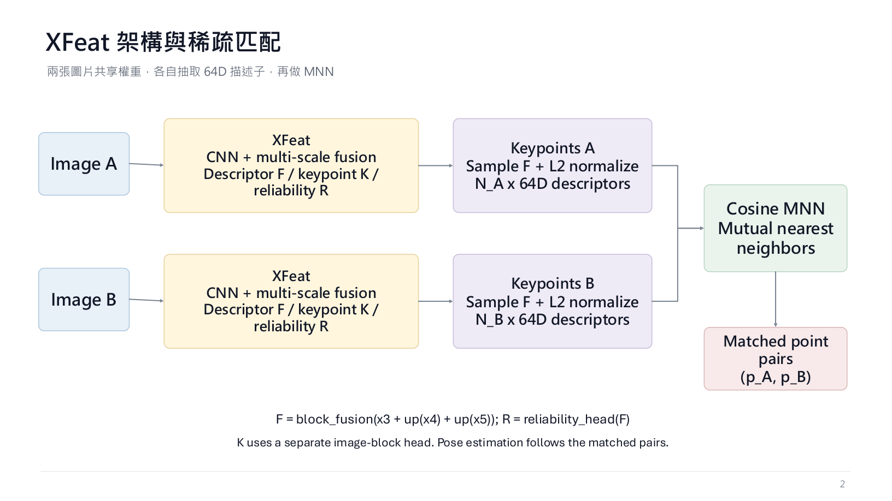
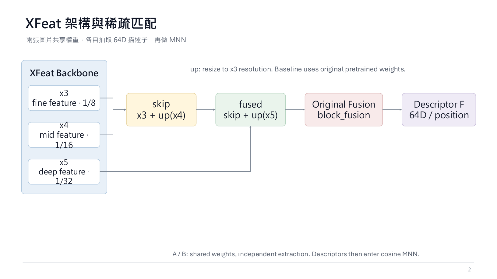
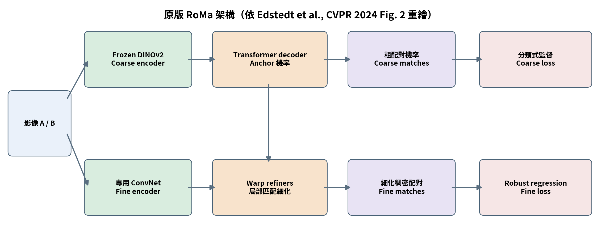

# XFeat × RoMa：從稀疏候選到全局粗到細影像配對

> I2ML-2026 Investigation Track 專題 README  
> 目標是分析 XFeat 為什麼快、RoMa 為什麼能處理更完整的對應，再測試哪些 RoMa 啟發的模組能在 XFeat 的效率條件下改善準確率。本文是研究計畫與組員交接文件；既有數字標示為歷史 pilot，不代表最後方法已經成功。

## 30 秒理解專案

給定兩張不同視角的場景影像，我們要找出代表同一個三維位置的對應點，讓後續幾何估計能恢復相機相對姿態。

XFeat 的優勢是輕量 CNN、短描述子與稀疏候選點，因此速度和記憶體成本低。它的限制是搜尋受到候選點集合約束：真實位置若沒有被選進候選集合，後續匹配器沒有機會輸出那個位置。

RoMa 的核心啟發是先用較粗的全局資訊尋找對應，再用連續座標與 coarse-to-fine 細化定位。這種搜尋較完整，但需要處理更大的特徵位置集合，成本也更高。

本專案的問題是：

> 能否保留 XFeat 的輕量 backbone，加入少量上下文、全局相關性與座標細化，改善搜尋與定位，同時量化每個模組的延遲和記憶體代價？



*圖 1：兩張影像經由共享 XFeat backbone 產生描述子，再進行候選點配對的概念示例。*


*圖 2：XFeat 論文 Figure 2 的配對結果裁切圖；上排是 sparse matching，下排是 semi-dense matching。綠色線段表示兩張影像間的對應，這些對應可交給相機姿態估計或 3D 重建使用。來源：[XFeat: Accelerated Features for Lightweight Image Matching, CVPR 2024](https://openaccess.thecvf.com/content/CVPR2024/papers/Potje_XFeat_Accelerated_Features_for_Lightweight_Image_Matching_CVPR_2024_paper.pdf)。圖片僅作課程研究說明，保留原論文圖說與來源。*

## 課程要求與研究範圍

本專案對應 [I2ML-2026 Investigation Track](https://nthu-cs-hmilab.github.io/I2ML-2026/project/)：

- 選擇一個既有 AI 系統並找出限制與失敗案例。
- 分析失敗發生在搜尋、定位、監督或計算成本的哪一層。
- 提出可控制、可重現的改善方法，而不是一次加入所有模組。
- 報告每位組員的實際貢獻、資料分割、設定、限制與失敗結果。

課程目前公布的時程：

| 事項 | 日期 |
|---|---|
| 3 分鐘 proposal video | 11/03 |
| 期末簡報 | 12/17、12/22、12/24 |
| Final report／code | 依課程後續公告 |

本專案不把任何現成權重當成新方法的證明，也不宣稱已經達到 RoMa 的準確率。所有結論都必須來自相同資料、相同姿態估計器和相同計時邊界。

## 影像配對的錯誤分解

完整流程可拆成四個階段：

```text
影像 A、B
  → 特徵提取
  → 搜尋可能的對應位置
  → 判斷配對並定位座標
  → 幾何姿態估計
```

我們分開記錄兩種主要錯誤：

- **搜尋錯誤**：正確對應沒有進入模型搜尋的區域，或一開始落到錯誤場景位置。
- **定位錯誤**：已經在正確位置附近，但最後座標誤差仍超過像素門檻。

上下文互動主要用來改善搜尋；粗細座標細化主要用來改善定位。把兩者一次接上會失去因果判讀，因此研究採階梯和消融。

## XFeat：效率從哪裡來，瓶頸在哪裡



*圖 3：XFeat 多尺度 CNN backbone 示意。正式實作以論文與本專案程式為準，圖片只用於組員理解。*

XFeat 使用共享權重的輕量 CNN，從每張影像產生多尺度特徵，再由 detector／reliability 路徑挑出有限的候選位置，為每個位置產生 64 維描述子。兩張圖的描述子相似度經過雙向一致性篩選後形成稀疏配對。

```text
Image A ─┐
         ├─ shared XFeat CNN ─ multi-scale maps ─ candidate points ─ 64D descriptors
Image B ─┘
                     └─ descriptor similarity + mutual filtering ─ matched pairs
```

它快的原因是只處理稀疏候選點，不建立兩張完整特徵圖的全位置兩兩關係。它的研究瓶頸是候選介面：

```text
真實連續位置：       ×
已選候選位置：          ●     ●
```

即使描述子正確辨認了同一個物體，候選位置仍可能離真值數個像素。這是「可搜尋位置」的限制，不能只靠把匹配 head 變大解決。

## RoMa：為什麼搜尋較完整



*圖 4：RoMa 的原始 coarse-to-fine 架構示意，依公開論文重繪。這裡借鑑的是全局搜尋、連續座標與粗到細 refinement 的設計原則。*

RoMa-style 流程先在較低解析度特徵上建立全局相關性：

```text
coarse feature A × coarse feature B
  → all-position correlation
  → softmax coordinate expectation
  → coarse coordinate refinement
  → fine feature refinement
  → final correspondence and confidence
```

若以粗特徵 F_A(i)、F_B(j) 表示兩張圖的位置，相關性可寫成：

$$
\frac{F_A(i)^\top F_B(j)}{\sqrt{d}}
$$

再對 B 圖的所有粗網格位置取 softmax 加權座標：

$$
\hat p_B(i)=\sum_j \operatorname{softmax}(C(i,j))_j\,p_B(j)
$$

因此輸出不必被固定候選點綁住，可以先得到連續的初始座標，再在附近做粗、細修正。代價是要處理更大的位置集合；如果粗階段已經跑到錯誤區域，後面的局部細化也不一定能救回來。

## 我們提出的研究架構

研究不直接重做完整 RoMa，而是固定 XFeat backbone，逐步加入可以獨立驗證的模組：

```text
XFeat shared CNN
  → coarse / fine feature maps
  → optional one-layer self-attention
  → global correlation
  → continuous coarse coordinate
  → optional coarse refinement
  → optional fine refinement
  → final correspondence
  → fixed pose evaluation
```


上圖是原始 RoMa 參考圖；本專案的實作架構以文字流程和實驗設定為準，不宣稱兩者完全相同。

三個主要假設：

- **H1：上下文假設。**粗匹配前加入一層圖內 self-attention，能利用同張圖的鄰近結構，減少重複紋理造成的錯誤。
- **H2：全局搜尋假設。**由完整粗特徵圖建立相關性，比固定稀疏候選更有機會涵蓋真實對應位置。
- **H3：定位假設。**若初始座標已在真值附近，粗細 refinement 能降低像素誤差；它不能保證修復遠距離的搜尋錯誤。
- **H4：成本假設。**互動深度與全局搜尋可能提升姿態準確率，但延遲、記憶體與資料搬移成本會限制可用深度。

## 既有實驗：只作為研究動機

下表來自先前研究脈絡的 78,042-step checkpoint、464 對歷史開發集。它們是 pilot，不是本課程專案的正式新訓練成果，也沒有代表未見場景泛化。

### 互動深度階梯

| 分支 | Frozen AUC@5 | Unfrozen AUC@5 | Frozen CPU s/pair | Unfrozen CPU s/pair |
|---|---:|---:|---:|---:|
| I0：投影與基本匹配頭 | 27.82% | 20.00% | 1.139 | 1.448 |
| I1：一層圖內上下文 | 32.55% | 37.42% | 1.469 | 1.678 |
| I2：一層圖內加跨圖互動 | 35.33% | 38.15% | 1.947 | 2.231 |
| I4：兩次重複互動 | 36.63% | 42.72% | 2.795 | 3.041 |
| I6：六次重複互動 | 46.85% | 49.10% | 6.128 | 6.390 |


這組結果顯示更深互動在該設定下可能提高 AUC，但代價明顯增加；解凍也不會保證每個分支都變好。因此第一個正式問題是找出「最低成本的有效互動深度」，不是直接選最深模型。

### 粗細定位階梯

| 分支 | Frozen AUC@5 | Unfrozen AUC@5 | Frozen CPU s/pair | Unfrozen CPU s/pair |
|---|---:|---:|---:|---:|
| L0：全局 correlation 與座標期望 | 5.59% | 7.92% | 1.507 | 1.525 |
| L1：L0 加粗尺度座標修正 | 5.27% | 15.65% | 1.981 | 1.992 |
| L2：L1 加細尺度座標修正 | 7.39% | 16.56% | 2.127 | 2.135 |


在這個 pilot 中，解凍條件由 L0 到 L1 增加 7.73 個百分點，再由 L1 到 L2 增加 0.91 個百分點。這支持優先檢查粗匹配與初始座標，但不能據此宣稱細化沒有價值。

### 單獨 XFeat 的速度參考

既有紀錄中，單張影像的 XFeat feature-only 平均時間為 **229.30 ms**；含讀取與前處理為 **239.08 ms**。這是單張、CPU、前端量測，不能直接與雙圖匹配的秒／pair 數字混算。

## 正式實驗矩陣

### 互動軸

| 代號 | 內容 |
|---|---|
| I0 | 描述子投影與基本匹配頭 |
| I1 | 加一層圖內 self-attention |
| I2 | 圖內互動後加入一層跨圖互動 |
| I4 | 重複兩次圖內／跨圖互動 |
| I6 | 重複六次圖內／跨圖互動 |

### 定位軸

| 代號 | 內容 |
|---|---|
| L0 | 全局 correlation 與連續座標期望 |
| L1 | L0 加粗尺度座標修正 |
| L2 | L1 加細尺度座標修正 |

每個分支都做兩種訓練條件：

- **Frozen**：固定 XFeat backbone，只更新新增的互動或定位模組。
- **Unfrozen**：XFeat backbone 與新增模組一起更新。

完整矩陣是互動階梯 5×2 與定位階梯 3×2；L0-Frozen 保留作為 forward-only 控制，不把沒有可訓練頭的控制誤報成訓練成果。

## 評估協定

- 訓練資料：MegaDepth 及其幾何標註；正式使用前記錄 manifest、scene split 和檔案 hash。
- 訓練 batch：8 對影像。
- 長訓目標：每個可訓練分支累計 2,000,000 次 image-pair exposure；這不是 2,000,000 組獨立影像對，也不是 optimizer steps。
- 姿態評估：固定 PoseLib 設定，在同一 464 對 dev split 上計算 AUC@5、AUC@10、AUC@20。
- 點級評估：correct@3、correct@5，並分開統計搜尋失敗與定位失敗。
- 速度：固定 1 CPU、0 GPU，報告平均、p50、p95 秒／pair；另記單張讀圖、前處理和 feature extraction。
- 資源：記錄參數量、峰值 GPU/CPU 記憶體、輸入解析度、seed、checkpoint、commit 和資料 hash。

AUC 是姿態誤差曲線面積，不是單一 5 度通過率；點級 correct 與 AUC 也不等價。所有模型必須使用相同資料、姿態 solver seed、計時起訖和輸出篩選規則。

## 實驗順序與決策規則

1. **固定基準**：先確認資料 manifest、split、幾何真值、loss、optimizer、checkpoint 格式和計時邊界。
2. **搜尋軸**：比較 I0→I1→I2→I4→I6，判斷最小有效上下文深度。
3. **定位軸**：比較 L0→L1→L2，判斷粗、細定位各自能救回多少錯誤。
4. **四組組合消融**：baseline、context-only、refinement-only、full hybrid；一次只改一個因素。
5. **失敗分析**：分開統計沒有候選、粗階段遠距離錯配、附近但像素不準、姿態 solver 失敗。
6. **成本門檻**：若 AUC 提升小於測量不確定度，或延遲／記憶體超過課程展示範圍，就停止加深並回到失敗分析。

每一個實驗開始前要寫清楚：它要改變哪個架構決策、目前證據缺口、預算、通過條件和停止條件。實驗結束後要記錄方法、數據、限制與下一步。

## 組員分工

| 角色 | 工作 | 交付 |
|---|---|---|
| 資料與評估 | manifest、geometry sanity、AUC/correct、split | evaluation script、protocol |
| 互動模組 | I0–I6、Frozen/Unfrozen、延遲 | model code、config、timing |
| 定位模組 | L0–L2、座標誤差與 rescue/failure 分析 | refiner code、tables |
| 系統與重現 | training entrypoint、checkpoint、環境 | run manifest、requirements、reproduce |
| 分析與簡報 | 圖表、消融、限制、proposal/final | figures、slides、contribution log |

每位組員需在 commit、experiment record 或報告中留下可辨識的實際貢獻。

## Repository 結構

```text
ML_FP/
├── README.md
├── assets/                  # README 圖片與小型圖表
├── src/                     # backbone、interaction、correlation、refinement
├── scripts/                 # train、evaluate、profile、failure analysis
├── configs/                 # 固定實驗設定
├── experiments/             # 每次 run 的 config、log、result、README
├── figures/                 # 報告用圖
└── requirements.txt
```

不提交影像、深度、私密資料、API key、虛擬環境或大型 checkpoint。大型結果只記錄外部路徑、hash、step 和取得方式。

## 目前狀態

已完成：

- XFeat 效率路徑、RoMa 全局與粗到細設計的問題定義。
- 互動深度與座標階梯的歷史 pilot。
- 464 對 dev 的 AUC 與 CPU 前端基準。
- 候選限制與粗階段錯誤的分開診斷。
- 本 README 所列圖片與組員研究流程。

尚未完成：

- 四組混合模型的正式訓練與比較。
- 未見場景泛化與多 seed 不確定度。
- 在同一硬體上完成完整 GPU/CPU/記憶體報告。
- 證明任何混合模型已經達到 RoMa 的準確率或速度。

## 第一週可執行清單

1. 確認組員、資料授權、計算資源和 proposal 分工。
2. 建立固定 manifest、pair hash 與 baseline evaluation。
3. 完成 L0-Frozen/L0-Unfrozen 的 import、forward、backward 檢查。
4. 先加入 L1，量測粗座標修正的 AUC、correct@3 和成本。
5. 以 I1 作為最低成本上下文候選，再決定是否進入 I2/I4。
6. 每次實驗在 experiments/YYYYMMDD_<cell>/README.md 記錄方法、數據、限制、下一步。

## 可重現原則

每筆結果至少要能回答：

- 使用哪個 commit、config、manifest 和 scene split？
- 更新幾步、看過多少 image-pair exposure？
- AUC 的資料、solver seed 和聚合方式？
- 計時是否包含讀圖、前處理、特徵、匹配與姿態？
- checkpoint 能否恢復，結果能否由原始 log 重算？

答案不完整時，標為 partial 或 diagnostic，不標為正式模型結論。

## 授權與資料

本 repository 只保存程式、設定、摘要、圖表與可重現紀錄。影像、深度、相機參數和外部權重依原始授權與課程規定取得；不可公開的資料不得 commit。
